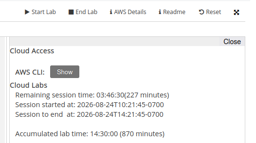

## Individual Terraform Setup

This Terraform setup aims to create a ready-to-go AWS setup that is *not secure*, not efficient but should be usable to create a testing setup for the pipeline.

Also, I have not setup the AWS EKS part here. I'm too lazy to research Kubernetes xd.

This setup includes

### Compute and Networking

All EC2 instances run the Debian AMI, using the `t3.micro` instance type.

- A VPC on `10.0.67.0/24`, with one Public subnet, and two private subnets
- Five EC2 instances:
  - One running Jenkins controller in the Public subnet
  - One running Nginx as a reverse-proxy in the Public subnet
    - This instance serves double-duty as a [NAT instance](https://docs.aws.amazon.com/vpc/latest/userguide/VPC_NAT_Instance.html)
  - One running the frontend in the private subnet
  - One running the Backend in the private subnet
  - One running a Jenkins agent (to build the thing) in the private subnet
- The frontend and Backend EC2 instances should have docker installed
- Two security groups: 

### Storage and Databases

- One S3 bucket configured with the LabRole access
- One RDS instance running PostgreSQL spanning across the 2 private subnets

### How to run

- Download [Terraform](https://developer.hashicorp.com/terraform) or [OpenTofu](https://opentofu.org/), and [Ansible](https://docs.ansible.com/projects/ansible/latest/index.html)
  - If you use Windows 11, these should be available via `winget`.
- Run `tofu init` or `terraform init` to set up the working environment
- Grab the **AWS Access key ID** and the **AWS Secret access key** from the Learner Lab launching page (picture below, click **Show** next to AWS CLI)

- Run `tofu plan` or `terraform plan` to check the AWS connection and see the changes being made.

### The Not-secure part

- SSH default port is enabled by default (port 22), so risk of scanning and attacking
- Everything is in the public subnet for easy software installation
  - NAT gateway is expensive:tm:
  - Egress-only IGW requires IPv6 support, something not all software repos provide (not least Jenkins)

### Credits

- Thanks [swyrin](https://github.com/swyrin) for the initial Terraform and Ansible config for the deployment of (the late) `akvns.org`.
  - You may find most of the references [here](https://github.com/cyberowl-town/akvns.org)
